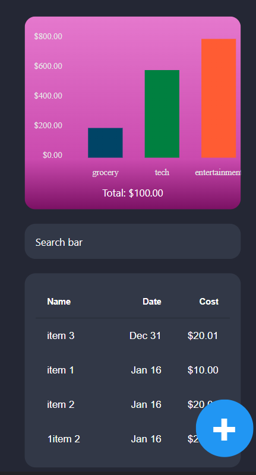

# Rereceipt

A receipt app

Figma: https://www.figma.com/file/E0aiQ9GR3Ih8GUPnLRbqzD/HackED2022?node-id=0%3A1

Jira/GitHub Board: https://github.com/users/Zeyu-Li/projects/16

## Run

Requires Node 22.13+ (Node 24 recommended) and [Yarn 1](https://classic.yarnpkg.com/).

1. Do `yarn install` to install dependencies
2. `yarn start` to run (Expo CLI ships with the `expo` package; no global install needed)
3. `yarn web` to do development on a web browser

## Screenshot

## Packages

* React native (Expo)
* React native paper
* React native chart kit

## Team

* Andrew Li - Tech lead, UI/UX
* Rachel Ellis
* Yi Meng Wang
* Anushka Khare
* Gokul Sivadasan

## License

 

